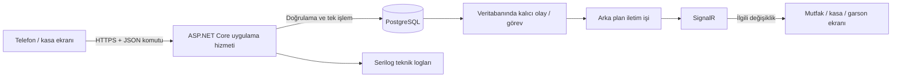

# Teknoloji ve veri iletişimi planı

**Tarihsel öneri — 21 Ekim 2026.** 22 Ekim'de kullanıcının kararıyla backend Node.js + Express.js, veritabanı MySQL olarak değişti ve ilk kurulum yapıldı. Aşağıdaki .NET/PostgreSQL/SignalR seçimi güncel uygulama kararı değildir. Güncel kurulum ve sonraki işler için [Altyapı](../altyapi.md) belgesini kullanın.

## 1. Önerilen teknoloji seçimi

| Katman | Seçim | Görevi |
|---|---|---|
| Bilgisayar ve telefon ekranları | React + TypeScript | Kasa, garson, mutfak, depo ve yönetici arayüzleri |
| Ana uygulama hizmeti | C# / ASP.NET Core, .NET 10 LTS | Yetki, fiyat, stok, sipariş, tahsilat ve iş kurallarını yönetme |
| İşlem gönderme ve veri sorgulama | HTTPS üzerinden HTTP API, JSON | Sipariş/ödeme komutları ve sayfalı kayıt sorguları |
| Anlık ekran güncellemeleri | ASP.NET Core SignalR | Mutfak, kasa ve garsonlara ilgili değişiklikleri iletme; uygun bağlantıda WebSocket kullanma |
| Kalıcı veritabanı | PostgreSQL 18, desteklenen güncel yama sürümü | Satış, stok, üretim, borç, ödeme ve iş geçmişini saklama |
| Uygulama-veritabanı erişimi | EF Core 10 + Npgsql 10, uyumlu yama sürümleri | İlişkili veri erişimi, işlem sınırları ve sürümlü şema değişiklikleri |
| Teknik loglar | Serilog + yapılandırılmış JSON dosyaları | Hata, süre ve bağlantı tanılarını boyut/tarih sınırlarıyla saklama |
| Kalıcı arka plan görevleri | PostgreSQL görev/outbox kayıtları + .NET BackgroundService | Bildirim, yazdırma ve uzun işlerin durumunu ve yeniden denemelerini izleme |
| İşletimde çalıştırma | Windows Service | Ana hizmeti bilgisayar açılışında başlatma ve kontrollü biçimde yönetme |

React/TypeScript arayüzünün derlenmiş dosyalarını aynı ASP.NET Core hizmeti sunacaktır. İşletimde ayrı bir ön yüz sunucusu çalıştırılması başlangıç mimarisinin parçası değildir. Derleme araçları geliştirme/yayınlama aşamasında kullanılır.

.NET 10, resmi destek politikasında LTS olarak listelenmektedir; 14 Kasım 2028'e kadar desteklenmektedir. Kullanıma geçişte desteklenen işletim sistemi ve güncel yamalar tekrar kontrol edilir. React/TypeScript ve diğer istemci paketlerinin kesin sürümleri geliştirme başlangıcında uyumluluk denemesiyle sabitlenir.

## 2. Bu seçimin işletmeye uygunluğu

- Kullanıcı cihazları Android, iPhone ve Windows olabilir; görev ekranları tarayıcıdan açılır.
- Windows kasa bilgisayarında tek ana uygulama hizmeti ve PostgreSQL birlikte çalışabilir. Gerekli donanım gerçek yük denemesiyle belirlenir.
- .NET hizmeti sipariş, stok, hesap ve kullanıcı modüllerini ortak kurallar altında yönetir. Modüller kod içinde ayrılır; başlangıçta tek uygulama hizmeti olarak dağıtılır.
- SignalR, kayıtlı değişiklikleri ilgili cihazlara ulaştırmak için seçilmiştir. Kalıcı kayıt ve işlem sonucu PostgreSQL/uygulama hizmetinden doğrulanır.
- Yerel yazdırma işlerinin Windows üzerinden yürütülmesi planlanır. Kullanıcıda birkaç Epson TM-U220B (bildirilen etiket: M188B) vardır; takılı bağlantı kartları, fiziksel durum ve sürücü uyumluluğu ayrıca denenir. Ayrıntılar [Donanım planı](donanim-plani.md) belgesindedir.
- Seçim; Windows üzerinde işletim, tek hizmetle bakım, eşzamanlı kayıt ve anlık güncelleme gereksinimlerine dayanır. Ölçülmüş bir dil/çatı performans üstünlüğü iddiası değildir.

## 3. Veri yolu

Telefonlar doğrudan SQL çalıştırmaz. Veritabanı hesabı ve bağlantı bilgileri kullanıcı cihazlarına dağıtılmaz. Her komut uygulama hizmetinde yetki ve veri doğrulamasından geçer.

## 4. Sipariş kaydı örneği

1. Garson, masadaki yeni ürünleri göndermek için benzersiz işlem kimliğiyle API'ye istek yollar.
2. Sunucu yetkiyi, adisyonun güncel durumunu, ürün/servis seçeneğini ve geçerli miktarı kontrol eder. Fiyat ve tutar hesaplarında sunucu kayıtları esas alınır.
3. Sipariş satırları, durum geçmişi ve gönderilecek olay aynı veritabanı işlemiyle yazılır. Stok hareketi, ürünün kararlaştırılmış tüketim aşamasında oluşturulur.
4. Veritabanı işlemi tamamlandıktan sonra kullanıcıya kayıt sonucu döner.
5. Kalıcı olay kaydını alan arka plan işi, ilgili mutfak/kasa/garson grubuna değişikliği bildirir.
6. Bir cihaz bildirimi kaçırmışsa yeniden bağlandığında güncel hesabı veya eksik değişiklikleri sunucudan alır.

Her mesajda bütün menü, stok ve satış geçmişi gönderilmez. Gerekli kimlik/sürüm ve değişen veriler taşınır; ayrıntı ihtiyaca göre sorgulanır.

## 5. Tutarlılık ve tekrar deneme

- Aynı işlem kimliğiyle tekrar gelen sipariş veya tahsilat ikinci kez uygulanmaz; önceki sonuç bulunur.
- Masa taşıma, hesap birleştirme ve tahsilat; güncel kayıt sürümü ve bakiye denetlenerek işlem içinde tamamlanır.
- İş kaydı ve iletilecek olayın birlikte yazılması, kayıt tamamlandıktan hemen sonra uygulamanın kapanması halinde olayın yeniden gönderilebilmesini sağlar.
- Olay iletimi yeniden denenebilir. Alıcı aynı olay kimliğini veya eski kayıt sürümünü tekrar uygulamaz.
- SignalR bağlantısının kurulması, bildirimin alınması veya bir düğmeye basılması tek başına tahsilat kanıtı değildir.
- Veritabanı commit sonucunun bağlantı hatası nedeniyle belirsiz kaldığı durumda aynı işlem kimliğiyle sonuç sorgulanır.
- EF Core'un tekrar deneme mekanizması bu iş kurallarının yerine geçmez.
- Fiziksel POS ilk kapsamda bağımsızdır; bu plan karttan otomatik çekim entegrasyonu kurmaz. Kaydedilen kart tahsilatının çoğalması önlenir.
- Yazıcı işleri bir göreve bağlıdır. Fiziksel çıktı ile yazılım onayı arasındaki kesintiler ele alınır; yeniden basım ayırt edilir. Kusursuz tek fiziksel çıktı garantisi varsayılmaz.

## 6. Yeniden bağlantı ve kesinti

- SignalR istemcisinde yeniden bağlantı açıkça yapılandırılır; ilk bağlantı hataları ayrıca ele alınır.
- Telefon uykuya girip döndüğünde, uygulama yeniden açıldığında veya ağ geldiğinde ilgili adisyon/bakiye sunucudan yeniden doğrulanır.
- Kullanıcıya işletmedeki ana hizmete erişim ve internet erişimi ayrı gösterilir.
- İnternet kesilse de ana bilgisayar ve yerel Wi-Fi çalışıyorsa HTTPS/API ve SignalR işletme içinde kullanılmaya devam eder.
- Telefon yerel ağdan koptuğunda kaydedilmemiş sipariş taslağı ile tamamlanmış kayıt birbirinden ayrılır.
- Ana bilgisayar veya yerel ağ kapanırsa ortak kayıt hizmeti etkilenir; yeniden çalışmaya başlama düzeni ayrıca planlanır.
- Uzaktaki yönetici işlemleri, yerel hizmet kabul edip kaydettiğinde tamamlanmış sayılır. Son alınmış rapor gösteriliyorsa zaman damgası bulunur.

## 7. Log ve iş geçmişi

### Kalıcı iş geçmişi — PostgreSQL

Satış, tahsilat, iptal, iade, indirim, fiyat değişikliği, stok düzeltmesi, üretim ve yetki/onay hareketleri ilgili iş kayıtlarına bağlı tutulur. Kullanıcı, zaman, kayıt kimliği, gerekçe ve gereken önceki/yeni değerler izlenir.

Bu kayıtlar mali ve stok doğrulamasının dayanaklarıdır. Teknik log temizleme politikasıyla silinmez. Düzeltme ve arşivleme yöntemleri ayrıca belirlenir.

### Teknik tanılama — Serilog

- Yapılandırılmış JSON kaydında olay türü, seviye, zaman, işlem/istek kimliği, ilgili kayıt, sonuç ve süre bulunabilir.
- Dosyalar tarih ve boyuta göre döndürülür; saklama süresi, dosya adedi ve toplam disk bütçesi belirlenir.
- Normal işletimde hata/uyarı ve gerekli özetler tutulur. Ayrıntılı tanılama gerektiğinde kontrollü süreyle açılır.
- Her ekran hareketinin tam gövdesini veya bütün veritabanı sorgularını sürekli kaydetmek esas alınmaz.
- Parolalar, kişisel PIN'ler, oturum anahtarları ve kart bilgileri loglara yazılmaz. Hata çıktılarında gereksiz kişisel veri sınırlandırılır.
- Teknik log yazım sorunu ile iş kaydının veritabanına yazılması ayrı izlenir. Kritik işlem denetimi, ilgili veritabanı işlemi içinde korunur.
- Teknik loglar için düşünülen boyut/süre limitleri gerçek işletim hacmiyle ayarlanır; bu belgede gelişigüzel kapasite sınırı verilmez.

### Yönetici/teknik durum ekranı

Ana hizmet ve veritabanı erişimi, son başarılı yedek, yazıcı görev hataları, biriken görevler, disk alanı ve son hata özeti gösterilir. İşletme sahibi günlük kontrolü buradan yapabilir; ayrıntılı teknik loglar yetkili bakım erişimine ayrılır.

## 8. Veri büyümesi ve yük kontrolü

- Toplam saklanan kayıt miktarı ile aynı anda gelen işlem sayısı ayrı ölçülür.
- API listeleri sayfalı ve filtreli olur; büyük geçmiş listeleri cihazlara tek seferde indirilmez.
- Barkod/kod, aktif hesap ve kişi/ürün-tarih sorgularına uygun veritabanı indeksleri kullanılır.
- Bağlantı havuzu ve arka plan işlerinin eşzamanlılığı ana bilgisayarın kapasitesine göre sınırlandırılır.
- Ağır rapor, Excel aktarımı ve büyük dışa aktarımlar ilerleme/durum bilgisiyle kontrollü işler olarak yürütülür.
- Günlük iş ekranlarıyla raporların birbirini gereksiz bekletmemesi ölçülür.
- Mesajlar yetkili cihaz gruplarına gönderilir; her değişiklik bütün cihazlara bütün veriyle yayımlanmaz.
- Veri hacmi, yedek süresi, disk büyümesi, hata sayısı ve bekleyen işlerin yaşı izlenir.
- Başlangıç dağıtımı bir uygulama hizmeti ve PostgreSQL ile planlanır. Ek kuyruk, önbellek, rapor veya log hizmetleri ölçülen ihtiyaçla değerlendirilir.
- Kesin kapasite ve yanıt süresi, temsili geçmiş veri ve eşzamanlı kasa/garson/mutfak senaryolarıyla sınanır.

## 9. İşletim ve donanım bağlantıları

- Ana uygulama ve veritabanı bilgisayar açılışında hizmet olarak başlatılır. Beklenmedik kapanma sonrası toparlanma ve kontrollü güncelleme adımları yazılır.
- Yerel erişim için kararlı adres/ağ düzeni ve Android/iPhone'un güvenle erişeceği HTTPS sertifikası planlanır. Bu düzen internet yokken de yerel adrese erişimi desteklemelidir.
- Yazıcı yönlendirme işi ana bilgisayardaki hizmet/uygun yerel bağlantı üzerinden yürütülür; telefonların her yazıcıya ayrı sürücü kurması esas alınmaz.
- Yedekler ana bilgisayardan ayrı hedefte, geri yükleme denemeleriyle birlikte planlanır.
- Uzak erişim yolu, ağ donanımı ve işletim maliyetine göre ayrıca seçilir. PostgreSQL doğrudan internete açılmaz.
- Bir bilgisayarın hizmet verebilmesiyle cihaz/ağ/güç arızasında kesintisiz çalışma aynı gereksinim değildir; yedekleme ve toparlanma hedefleri donanım kararıyla birlikte belirlenir.

## 10. Sonraki planlama çıktıları

1. Ekranlardan API'ye gönderilecek komut ve sorgu listesi.
2. Adisyon, stok, üretim, ödeme ve cari kayıtlarının ilişki şeması.
3. Her kritik işlemin doğrulaması, işlem sınırı ve tekrar deneme davranışı.
4. Bildirim olayları, alıcı grupları ve yeniden bağlantıda güncelleme kuralları.
5. İş geçmişi alanları, teknik log kapsamı, saklama ve disk bütçesi.
6. Ağ/HTTPS, yazıcı uyumluluğu, yedekleme ve yük denemesi planı.

Mevcut HTML ekran taslağı bu teknoloji yığınının uygulanmış hali değildir. Taslakta kararlaştırılan kullanıcı akışı, bu mimariyle geliştirilecek programa aktarılacaktır.

## 11. Resmi kaynaklar

- [.NET destek ve LTS politikası](https://dotnet.microsoft.com/en-us/platform/support/policy/dotnet-core)
- [ASP.NET Core SignalR genel bakış](https://learn.microsoft.com/en-us/aspnet/core/signalr/introduction?view=aspnetcore-10.0)
- [SignalR JavaScript istemcisinde yeniden bağlantı](https://learn.microsoft.com/en-us/aspnet/core/signalr/javascript-client?view=aspnetcore-10.0#reconnect-clients)
- [.NET Windows Service kullanımı](https://learn.microsoft.com/en-us/dotnet/core/extensions/windows-service)
- [React ve TypeScript](https://react.dev/learn/typescript)
- [Npgsql EF Core 10 sağlayıcısı](https://www.npgsql.org/efcore/release-notes/10.0.html)
- [Serilog dosya, JSON ve döndürme seçenekleri](https://github.com/serilog/serilog-sinks-file)
- [EF Core commit hatası ve tekrar uygulama riski](https://learn.microsoft.com/en-us/ef/core/miscellaneous/connection-resiliency#transaction-commit-failure-and-the-idempotency-issue)
- [PostgreSQL mimarisi](https://www.postgresql.org/docs/current/tutorial-arch.html)
