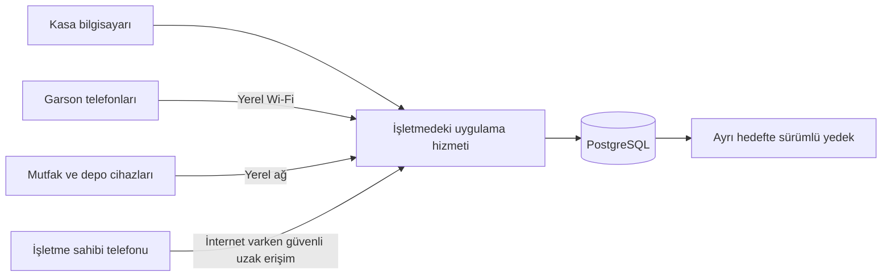

# Kalıcı veri ve veritabanı planı

**Tarihsel mimari öneri — 21 Ekim 2026.** İş kuralları ve veri ihtiyaçları referans olarak saklanır. 22 Ekim'de PostgreSQL yerine MySQL seçildi ve Node.js + Express backend bağlantısı kuruldu. Aşağıdaki PostgreSQL ve .NET'e özgü seçimler güncel değildir. Güncel teknik durum: [Altyapı](../altyapi.md). Mevcut ekran taslakları hâlâ örnek işlemlerle çalışır.

Uygulama hizmeti, veri aktarımı, anlık bildirim ve log teknolojileri [Teknoloji planı](teknoloji-plani.md) belgesinde tanımlanmıştır: ASP.NET Core / .NET 10 LTS, HTTPS/JSON API, SignalR, React/TypeScript ve Serilog. PostgreSQL erişimi için EF Core/Npgsql planlanmıştır.

## 1. Ana karar

Önerilen ana veritabanı PostgreSQL'dir. Tercihin nedeni yalnızca kayıt sayısı değil; kasa, garson, mutfak ve depo işlemlerinin aynı anda tek kayıt merkezi üzerinden yürütülmesi, işlem tutarlılığı, raporlama ve geri dönüş gereksinimleridir.

Başlangıç yerleşimi: İşletme için alınacak bilgisayarda uygulama hizmeti ve veritabanı birlikte çalışır. Ek bir fiziksel sunucu ihtiyacı, gerçek iş yükü ve ölçümlerle değerlendirilir. Bu plan belirli bir bilgisayarın yeterli olacağını veya belirli bir yanıt süresini henüz garanti etmez.

PostgreSQL yazılımı için lisans bedeli gerekmez. Geliştirme, bakım, donanım, uzak erişim ve yedekleme hedefi maliyetleri ayrıca değerlendirilir.

## 2. Cihazların bağlantısı

- Telefonlar ve ekranlar veritabanına doğrudan bağlanmaz; yetkili işlemleri uygulama hizmetine iletir.
- Telefonlarda veritabanı kullanıcı adı/parolası bulunmaz. Veritabanı doğrudan internete açılmaz.
- Yerel ağ, ana bilgisayar ve uygulama çalışırken internet kesilmesi işletme içi işlemleri durdurmaz.
- Wi-Fi/yerel ağ, ana bilgisayar veya elektrik kesintisi farklı arızalardır; bu durumlarda kaydedilmeyen işlem başarılı gösterilmez.
- İşletme dışından anlık erişim internet bağlantısına bağlıdır. Son aktarılmış rapor gösteriliyorsa güncellenme zamanı görünür olur.
- İlk mimaride ortak kayıt otoritesi işletmedeki veritabanıdır. Bulut kopyası varsa yedek/rapor amaçlı rolü ayrıca tanımlanır; birbiriyle çakışan iki bağımsız satış merkezi kurulmaz.
- Yerel ağdan kopmuş telefonun tek başına satış tamamlaması bu ilk çevrimdışı kapsamın parçası değildir. Gönderilmeyen taslak ile kaydedilmiş işlem ayrılır.

## 3. Kaydedilecek veri grupları

| Veri grubu | İçerik | Bağlandığı işler |
|---|---|---|
| Ürünler ve birimler | Ürün kimliği, barkod, kategori, alış/satış/stok birimi, aktiflik | Satış, alış, stok, Excel |
| Servis ve fiyat sürümleri | PET/standart bardak, porsiyon/gram, hacim, gramaj, ambalaj, geçerlilik ve fiyat | Adisyon, maliyet, hazırlık |
| Masalar ve bölümler | Masa kimliği, adı, bölüm, kullanım durumu | Masa ekranı ve hesap atamaları |
| Adisyonlar ve ürün satırları | Sabit adisyon/satır kimliği, ürün, miktar, not, servis ve durum | Garson, kasa, mutfak |
| Masa atama ve birleştirme geçmişi | Kaynak/hedef, eski/yeni ilişki, yapan kişi ve zaman | Hesabı taşıma, ortak tahsilat |
| Sipariş durum geçmişi | Gönderildi, hazırlanıyor, hazır, teslim, iptal ve gerekçe | Mutfak, tüketim, denetim |
| Ödemeler ve tahsilat dağılımları | Nakit/kart, tahsil eden kişi, bağlı hesap, kısmi ödeme/iade | Kasa, masa, cari |
| Kasa ve vardiya hareketleri | Açılış, para giriş/çıkışı, teslim, sayım, fark ve kapanış | Kasa kontrolü |
| Stok partileri ve hareketleri | Ürün, parti, miktar, maliyet dayanağı, tarih, kaynak işlem | Depo, satış, üretim, iade |
| Reçete sürümleri ve hazırlama | Malzemeler, gerçek girdi/çıktı, hazırlayan kişi, hazırlama partisi | Yemek, ayran, maliyet |
| Alış ve mal kabulü | Tedarikçi, satırlar, gerçek birim dönüşümleri, ödenen/borç, vade, iade | Stok ve tedarikçi hesabı |
| Müşteri/tedarikçi ve cari hareketler | Açılış, veresiye, alış borcu, tahsilat/ödeme ve mahsup | Borç/alacak takibi |
| Gider, ekipman ve personel ödemeleri | Kategori, belge, tutar, ödeme durumu, avans/ödeme türü | İşletmenin bütün harcamaları |
| Fire ve diğer tüketimler | Bozulma, dökülme, personel, ikram, kişisel kullanım | Stok ve maliyet raporları |
| Kullanıcı, rol ve onay kayıtları | Kişisel hesap, yetki, limit, talep ve onay | Bütün işlemler |
| Excel aktarım kayıtları | Dosya/aktarım kimliği, satır önizlemesi, hatalar ve sonuç | Başlangıç kayıtları ve aktarım kontrolü |
| İşlem geçmişi ve görev kayıtları | Kim/ne zaman, değişiklik nedeni, yazıcı/rapor/yedek işi | Denetim ve işletim |
| Dosya ekleri | Dosya kimliği, konumu, türü ve bağlı kayıt | Alış/gider belgesi ve yedekleme |

Bu gruplar tek bir büyük tablo halinde tutulmaz. Kesin tablo adları ve alanlar geliştirme öncesinde ilişki şemasıyla ayrıntılandırılır.

## 4. Kayıt kimlikleri ve geçmişin korunması

- Masa ile adisyon ayrı varlıklardır. Adisyonun kimliği masa değişince değişmez.
- Boş masaya taşıma bir masa atama hareketidir; satış, ödeme veya stok tüketimi yeniden oluşturulmaz.
- Dolu masada hesap birleştirildiğinde önceki adisyonlar ve ödeme bağlantıları korunur; ortak tahsilat grubu altında ilişkilendirilir.
- Satış anındaki ürün adı, servis, birim fiyat, miktar, ölçü dönüşümü ve maliyet dayanağı işlem üzerinde saklanır. Sonradan ürün/fiyat/reçete değişmesi geçmişi değiştirmez.
- Ürünler, kullanıcılar ve masalar kullanımdan kaldırılabilir; geçmiş işlemlerin dayanakları silinmez.
- Tamamlanmış işlemlerde düzeltme, iptal/iade ve karşı hareketler ilk kayda bağlı tutulur.
- Tarih/saatler zaman dilimi bilgisiyle saklanır; ekranlar Europe/Istanbul'a göre gösterir.
- Parasal tutarlar kesin ondalık veya kuruş temsiliyle, gramaj/hacim ve birim maliyetleri gereken ayrı hassasiyetle tutulur. Yuvarlama kuralları tek yerde tanımlanır.

## 5. Stok ve üretim modeli

- Her değişimin bir hareket kaydı olur: mal girişi, satış/tüketim, hazırlama, fire, iade, sayım farkı.
- Stok bakiyesi hareketlerden doğrulanabilir. Hız için bakiye özeti tutulursa hareketle aynı işlem içinde güncellenir ve yeniden hesaplanabilir olur.
- Parti ve son kullanma tarihi gerektiğinde hareketle ilişkilendirilir; gerçek kullanılan parti izlenebilir olmalıdır.
- Kova gibi değişken ambalajların içeriği sabit varsayılmaz. İlgili mal kabulü veya kullanımda gerçek içerik miktarı belirlenir.
- Ayran hazırlığında kullanılan yoğurt ve diğer girdiler tüketilir; çıkan gerçek ayran miktarı litre olarak yeni hazırlama partisine eklenir.
- Bardak satışında bu partiden tanımlı mililitre kadar ayran ve varsa bir adet tek kullanımlık bardak tüketilir. Yoğurt ikinci kez düşmez.
- Gramla dondurma satışında tartılan gerçek gram kaydedilir. Porsiyonla satışta o satışa ait porsiyon gramajı saklanır.
- Hazırlanmadan iptal ile hazırlanıp tüketilemeyen ürün ayrı işlenir; stok sonucu otomatik ve yanlış bir geri eklemeye dönüşmez.
- Toplam hazırlama miktarı ve bardak hacmi kaydedilmeden yalnızca bardak sayısıyla farklı hazırlamaların maliyeti karşılaştırılmaz.

## 6. Para ve borç modeli

- Satış kaydı, tahsilat, müşteri borcu ve tedarikçi borcu birbirinden ayrılır; ilişkileri korunur.
- Nakit ve kart tahsilatı kasanın/ödeme yönteminin hareketidir. Veresiye yazılan tutar nakit veya kart tahsilatı sayılmaz.
- Eski müşteri borcunun ödenmesi ikinci bir satış oluşturmaz.
- Alış kaydı, stok girişi ve tedarikçi borcu tek alışa bağlanır. Aynı tutar farklı ekranda yeniden gider yazılarak çoğaltılmaz.
- Müşteri/tedarikçi bakiyeleri hareketlerinden doğrulanabilir olur.
- Personelin masada aldığı nakit ile bu nakdi kasaya teslim etmesi ayrı olaylardır; aynı para iki tahsilat gibi sayılmaz.
- Fiziksel POS ilk kapsamda bağımsızdır. Veritabanına kart ödeme kaydının yazılması cihazdan kart tahsilatı yapıldığı anlamına gelmez.

## 7. Aynı anda işlem ve tekrar gönderim

PostgreSQL'in işlem mekanizması, bağlantılı kayıtların birlikte tamamlanması için kullanılacaktır. Bu davranış yalnızca veritabanı seçilerek otomatik oluşmaz; uygulama akışında tasarlanır ve test edilir.

- Tahsilatın ödeme, hesap dağılımı ve kasa/cari kayıtları birlikte tamamlanır veya tamamı geri alınır.
- Hazırlamada malzeme çıkışı ile hazır ürün girişi birlikte tamamlanır.
- Masa taşıma/birleştirmede kaynak, hedef, hesap ilişkileri ve işlem geçmişi birlikte güncellenir.
- Bir hesabı kasiyer ve garson aynı anda kapatmaya çalıştığında güncel bakiye ve kayıt sürümü esas alınır.
- Her gönderim isteğinin tekrar tanınabilen bir kimliği olur. Bağlantı kopup tekrar gönderilen aynı istek ikinci sipariş, ödeme veya stok hareketi yaratmaz.
- Bağlantı, kayıt tamamlandıktan sonra yanıt gelmeden koparsa aynı istek kimliğiyle kayıt sonucu sorgulanır; kullanıcıdan körlemesine ikinci ödeme girmesi istenmez.
- Yazıcıya çıktı veya dış hizmet çağrısı beklenirken veritabanı işlemi uzun süre kilitli tutulmaz. Çıktı işleri kalıcı görev kaydına bağlı yürütülür; tekrar basımlar ayırt edilir.
- İlişkiler ve zorunlu/benzersiz alan kuralları veritabanında da korunur. Uygulama yetkileri her istekte kontrol edilir.

## 8. Çok veri olduğunda hız

- Liste ekranları bütün yılların verisini bir anda indirmez; arama, tarih filtresi ve sayfalama kullanır.
- Barkod/kod araması, aktif adisyonlar, ürün-tarih stok hareketleri ve kişi-tarih cari hareketleri için sorguya uygun indeksler planlanır.
- Sık kullanılan ilişki alanlarının indeksleri sorgu planlarıyla değerlendirilir; her alana rastgele indeks eklenmez.
- Günlük satış ekranı ile uzun dönem raporlar farklı sorgular kullanır. Büyük rapor/Excel çıktıları arka plan görevi olarak hazırlanabilir.
- Özetler gerektiğinde yeniden üretilebilir; asıl işlem geçmişi korunur.
- Belge/görsel gibi büyük ekler ayrı dosya alanında tutulabilir; veritabanı bunların kimlik ve bağlantılarını saklar. Yedekleme dosyaları da kapsar.
- Saklama ve arşivleme süresi ayrıca belirlenir. Açık borç, devam eden hesap veya geçmiş maliyet dayanağı otomatik silinmez.
- Bölümleme veya ayrı rapor veritabanı gibi ek karmaşıklıklar ölçüm gerektirdiğinde değerlendirilir.
- Boyutlandırma girdileri: günlük adisyon/market fişi, ortalama ürün satırı, eşzamanlı cihaz, stok hareketi, belge eki hacmi ve saklanacak yıl sayısı.
- Temsili veri ve yoğun saat işlemleriyle yük denemesi yapılmadan kayıt kapasitesi veya hız garantisi verilmez.

## 9. Yedekleme ve geri dönüş

- Otomatik, tutarlı, tarihli ve birden fazla sürümü koruyan yedekler planlanır.
- Ana bilgisayardan ayrı bir yedek hedefi bulunur; aynı diskte ikinci dosya tek başına yeterli kurtarma planı değildir.
- İnternet varsa işletme dışı şifreli kopya hedefi ayrıca kullanılabilir. Ağ kesintisinde kopyalama durumu izlenir; son başarılı yedek zamanı gösterilir.
- Veritabanı, belge ekleri ve gereken uygulama ayarları birlikte geri getirilebilir olmalıdır.
- Yedek yöntemi ve sıklığı, kabul edilebilir en fazla veri kaybı ile yeniden çalışmaya başlama süresine göre seçilir. Yalnızca günlük yedek alınması gün içindeki her işlemi koruyor sayılmaz.
- Geri yükleme ayrı bir ortamda denenir: siparişler, stok, borçlar, kasa ve dosya ekleri doğrulanır.
- Yeni bilgisayara geri dönüş ve telefon/kasa/mutfak bağlantılarının yeniden kurulması yazılı adımlara bağlanır.
- Yedek dosyası olması ile çalışır bir geri dönüşün doğrulanması ayrı kontrollerdir.

## 10. Excel aktarımı ve başlangıç

- Dosya önce geçici aktarım alanına alınır; doğrulama bitmeden canlı ürün/borç/stok kayıtlarına uygulanmaz.
- Ürün kodu/barkod, birim, fiyat, tarih ve referanslar kontrol edilir. Mükerrer dosya/satır ve güncelleme davranışı önizlemede gösterilir.
- Başlangıç stoku ve borçlar açılış hareketleridir; yeni alış veya satış gibi tekrar sayılmaz.
- Onaylanan aktarımın kimliği, sonuç özeti ve yapan kişi saklanır; hatalı aktarımın düzeltme yöntemi tanımlanır.

## 11. Geliştirme öncesi hazırlanacaklar

1. Ekran planıyla bağlantılı ilişki şeması ve alan listesi.
2. Para, miktar, fiyat/gramaj sürümü ve maliyet hesap kuralları.
3. Sipariş, hazırlama, stok tüketimi, tahsilat ve taşıma işlemlerinin işlem sınırları.
4. Excel şablonları ve başlangıç sayımı/borç aktarımı düzeni.
5. Kabul edilebilir veri kaybı ve geri dönüş süresiyle birlikte yedekleme düzeni.
6. İş yükü ölçümü, donanım gereksinimleri ve işletim sorumluluğu.

Bu belge veritabanının plan içindeki yerini ve temel kuralları belirler. Kurulum, veri taşıma ve canlı kullanıma geçiş ayrı geliştirme aşamalarıdır.

## 12. Teknik dayanaklar

- [PostgreSQL istemci/sunucu mimarisi](https://www.postgresql.org/docs/current/tutorial-arch.html)
- [PostgreSQL işlemler ve kalıcılık](https://www.postgresql.org/docs/current/tutorial-transactions.html)
- [PostgreSQL yedekleme ve geri yükleme](https://www.postgresql.org/docs/current/backup.html)
- [PostgreSQL lisansı](https://www.postgresql.org/about/licence/)
- [SQLite kullanım alanları ve eşzamanlılık değerlendirmesi](https://www.sqlite.org/whentouse.html)

SQLite'ın tek bir uygulama hizmetinin arkasında kullanılabildiği durumlar vardır; bu plan onu yalnızca veri miktarı nedeniyle yetersiz ilan etmez. PostgreSQL önerisi, işletmenin ortak veri merkezi ve eşzamanlı işlem gereksinimine dayanan mimari tercihtir.
