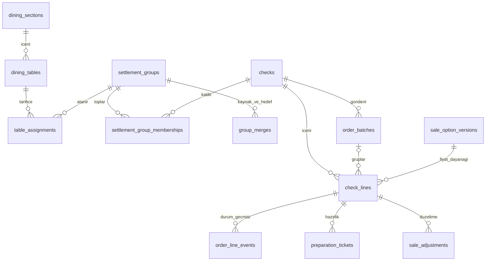
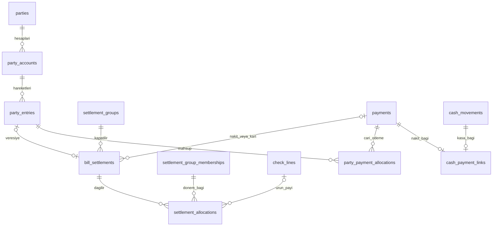
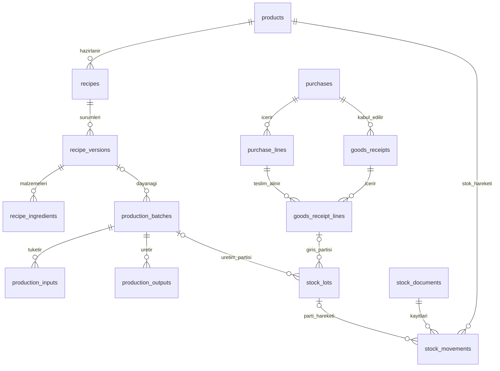

# MySQL tablo ve ilişki şeması — temel model 22 Ekim 2026

Bu belgedeki v2 uygulama kaydı tarihlidir. Güncel kaynak sürümü v8; sonraki sürümler ve dosyaları [şema kartındadır](moduller/schema.md). Bu görevde canlı şema yeniden denetlenmedi.

Bu belge [ekran planındaki](planlama/ekran-plani.md) masa, adisyon, market satışı, tahsilat, mutfak, üretim, stok ve cari hesap akışlarını MySQL 8 ilişkilerine dönüştürür. [Önceki veritabanı planının](planlama/veritabani-plani.md) iş kuralları korunur; güncel teknoloji Node.js 24 + Express 5 + mysql2 + MySQL 8'dir. Teknik işletim kararları [altyapı belgesindedir](altyapi.md).

Çalıştırılabilir tablo tanımları aşağıdaki dört migration modülündedir. **22 Ekim'de `nar_cicegi` veritabanına şema sürümü 2 uygulandı:** 75 iş tablosu + 2 altyapı tablosu. Mevcut ayar kayıtları korundu; iş tablolarına örnek veya doğrulanmamış başlangıç verisi eklenmedi. Tabloların bulunması, satış servislerinin ve ekran bağlantılarının tamamlandığı anlamına gelmez.

| Kaynak dosya | Kapsam |
|---|---|
| [002-core-catalog.js](../backend/src/migrations/002-core-catalog.js) | Kullanıcı/yetki, işlem kimliği, ürün, birim, servis/fiyat ve reçete |
| [002-sales-finance.js](../backend/src/migrations/002-sales-finance.js) | Masa, adisyon, sipariş, tahsilat ve cari hesap |
| [002-stock-purchasing.js](../backend/src/migrations/002-stock-purchasing.js) | Alış, mal kabulü, üretim, stok, gider ve ödeme dağılımları |
| [002-operations.js](../backend/src/migrations/002-operations.js) | Kasa, onay, aktarım, yazdırma, yedek ve denetim |

## Ortak kayıt kuralları

- Kimlikler `BIGINT UNSIGNED` ve yabancı anahtarlarla ilişkilidir. Tarihsel iş kayıtları silinerek düzeltilmez; karşı hareket, iade veya gerekçeli düzeltme kullanılır. Bu değişmezlik kuralının servis katmanında uygulanması gerekir.
- Ödeme ve belge tutarlarında `*_minor` alanları tam kuruş tutan `BIGINT` değerlerdir: 125,50 TL = `12550`. Kısmi maliyet oranları `DECIMAL(20,6)` ile kuruş/baz birim hassasiyetinde tutulabilir. JavaScript hesapları kayan noktalı `Number` ile yapılmamalı; büyük tam sayılar kayıpsız taşınmalıdır.
- Miktarlar `DECIMAL(18,6)` ile tutulur. `quantity_base` alanı ürünün seçilmiş stok baz birimindedir; satıştaki `quantity`, ilgili servis sürümünün satış birimindedir. Birimlerin boyutu (`count`, `mass`, `volume`, `portion`, `package`) ve ürün bazında dönüşümü ayrıca tanımlıdır. Kova içeriği gibi değişken miktarlar alış satırında gerçek baz miktarı olarak saklanır.
- Fiyat `unit_price_minor / price_basis_quantity` üzerinden yorumlanır. Örneğin satış birimi gram, fiyat dayanağı 1000 gram ve fiyat 60000 kuruşsa 250 gramın ara toplamı 15000 kuruştur. Yuvarlama ve bölünmüş ödemede kuruş paylaştırma tek servis kuralıyla yapılmalıdır.
- Zaman alanları `DATETIME(6)` ile UTC saklanır; MySQL türü zaman dilimi taşımadığı için yazan bağlantı/servis UTC kuralına uymalıdır. Ekranlarda `Europe/Istanbul` gösterilir. Vade ve alım günü gibi yalnızca gün belirten alanlar `DATE`'tir.
- Satış satırı ürün adı, servis adı, birim, fiyat dayanağı, miktar, fiyat ve içerik miktarının işlem anındaki kopyasını tutar. Fiyat/servis ve reçete sürümleri eski işlemleri değiştirmeden yenilenir.
- Asıl stok, cari ve kasa hareketleri ilişkiseldir. JSON alanları aktarım önizlemesi, görev yükü, sonuç veya denetim metaverisi içindir; para ve stok kayıtlarının yerine geçmez. Gizli bilgi veya ham hata metni burada tutulmaz.

## Ürün, servis ve reçete

| Tablo | Görevi |
|---|---|
| `units` | Adet, gram, mililitre, porsiyon ve paket gibi ölçü tanımları |
| `warehouses` | Stok hareketlerinin depo/konum tanımları |
| `product_categories` | Menü ve ürün listesi kategorileri |
| `preparation_stations` | Mutfak ve bar gibi hazırlık yerleri |
| `products` | Satılan, hazırlanan, malzeme veya sarf ürünleri; stok yöntemi ve düşüm aşaması |
| `product_unit_conversions` | Ürüne özel alış/servis biriminin baz miktara dönüşümü |
| `sale_options` | Ürünün Tam/Yarım, bardak/PET, dürüm/porsiyon gibi servis seçenekleri |
| `sale_option_versions` | Servisin fiyatı, birimi, fiyat dayanağı, içerik miktarı ve tartım gereksiniminin sürümü |
| `sale_option_components` | Servisle tüketilen bardak gibi ek ürünler ve baz miktarları |
| `product_barcodes` | Barkodu ürün ve gerekiyorsa belirli servis seçeneğiyle eşleştirir |
| `product_favorites` | Bütün çalışanların kullanacağı ortak favori ürün listesi |
| `recipes` | Hazırlanan ürünün reçete kimliği |
| `recipe_versions` | Standart çıktı miktarıyla birlikte reçetenin değişmez sürümü |
| `recipe_ingredients` | Reçete sürümünün malzemeleri ve baz miktarları |
| `sale_option_recipes` | Siparişe göre hazırlanan servisi reçete sürümü ve çarpanıyla bağlar |

`stock_mode = direct` üründen, `recipe` reçetenin girdilerinden düşüm gereksinimini; `stock_timing` düşümün satış, gönderim, hazırlık veya elle işlem aşamasını ifade eder. Aynı ürün için iki kez tüketim yaratılmaması servis kuralıdır. Referans menüdeki 85 ürün ve 94 fiyat seçeneği bu tablolara kontrollü aktarılabilir; doğrulanmamış hacim, reçete veya fiyatlar kendiliğinden kesin kayıt sayılmaz.

## Masa, adisyon ve sipariş

| Tablo | Görevi |
|---|---|
| `dining_sections` | Salon/bahçe gibi masa bölümleri |
| `dining_tables` | Fiziksel masa tanımları |
| `checks` | Masa adisyonu veya hızlı market satışının sabit kimliği |
| `settlement_groups` | Birlikte tahsil edilecek bir veya daha çok adisyonun hesap grubu |
| `settlement_group_memberships` | Adisyonun gruba katılma/ayrılma tarihçesi |
| `table_assignments` | Hesap grubunun masaya atanma ve masadan ayrılma tarihçesi |
| `group_merges` | Birleştirmede kaynak/hedef grup, işlem, gerekçe ve kullanıcı |
| `order_batches` | Tek gönderimde mutfak/bara iletilen sipariş grubu |
| `check_lines` | Ürün, servis sürümü, miktar, not ve fiyat kopyası içeren satış satırı |
| `order_line_events` | Gönderildi, hazırlanıyor, hazır, teslim ve iptal geçmişi |
| `preparation_tickets` | Satırın ilgili mutfak/bar kuyruğundaki çalışma durumu |
| `sale_adjustments` | İptal, iade, ikram ve indirim; gerekçe, yapan kişi ve gerekirse onay |

Boş masaya taşıma eski `table_assignments` kaydını kapatır ve yeni atama açar. Adisyon, sipariş satırları ve önceki ödemeler aynı kimlikte kalır. Dolu hesap birleştirmede eski grup üyelikleri kapatılıp hedef grup üyelikleri açılır; kaynak grup `merged` olur ve `group_merges` kaydı oluşur. Geçmiş ödeme/dağılım satırları yeni grup kimliğiyle yeniden yazılmaz. Birleştirilen grupların geçmiş tahsilatları ilişki zinciri üzerinden okunur; aynı ödeme ikinci kez sayılmaz. Bu adımların birlikte ve döngü yaratmadan yürütülmesi transaction servisinin görevidir.

## Tahsilat, veresiye ve cari

| Tablo | Görevi |
|---|---|
| `parties` | Müşteri, tedarikçi veya her ikisi olan kişi/işletme |
| `party_accounts` | Aynı kişinin TRY alacak ve borç hesaplarını ayırır |
| `party_entries` | Açılış, veresiye, alış, ödeme, iade, avans ve düzeltme hareketleri |
| `payments` | Gerçek nakit/kart para giriş veya çıkışı; tahsil eden, vardiya ve ters kayıt bağlantısı |
| `bill_settlements` | Bir hesap grubunun ödeme veya veresiye ile kapatılan/iade edilen tutarı |
| `settlement_allocations` | Kapatma tutarının adisyona ve isteğe bağlı ürün miktarına dağılımı |
| `party_payment_allocations` | Gerçek ödemenin cari harekete dağıtılan tutarı |
| `cash_payment_links` | Nakit ödeme ile kasa hareketinin bire bir bağı |
| `party_entry_sources` | Cari hareketin satış, alış veya gider dayanağı |
| `purchase_payment_allocations` | Ödemenin alışa dağılımı |
| `expense_payment_allocations` | Ödemenin gidere dağılımı |

`payments.method` yalnızca `cash` veya `card` alır. Veresiye, para gelmiş gibi bir ödeme kaydı oluşturmaz; müşteri `party_entries` hareketi ve ona bağlı `bill_settlements` ile temsil edilir. `bill_settlements` satırında ödeme veya veresiye hareketinden tam biri zorunludur. Eski veresiye tahsilatı `payments` ve cari mahsup yaratır, yeni satış yaratmaz. Kart kaydı fiziksel POS cihazından çekim yapıldığı anlamına gelmez.

Ürün seçerek ödeme için `settlement_allocations.check_line_id` ve `quantity` doludur; yalnızca tutarla alınan ödemede ikisi de boştur. Üç tostun birini ödeme ve gramla satılan ürünün bir kısmını ödeme bu şekilde ayrılır. Satır miktarı/toplam tutar aşımı, önceki dağılımsız tahsilatın etkisi ve son kuruşun paylaştırılması kilitli güncel kayıtlarla hesaplanmalıdır.

Cari bakiye `party_entries` hareketlerinin işaretli toplamından türetilir. Borcu artıran/azaltan işaretin alacak/borç hesabına göre anlamı servis ve raporlarda ortak tanımlanmalıdır. Ödeme dağılımları borç kapatma ilişkisidir; dağılım tek başına yeni cari hareket veya yeni para girişi değildir.

## Alış, üretim ve stok

| Tablo | Görevi |
|---|---|
| `purchases` | Tedarikçi alış belgesi, toplam, vade ve durum |
| `purchase_lines` | Alınan miktar/birim, gerçek baz miktarı ve fiyat kopyası |
| `goods_receipts` | Alışa bağlı, belirli depoya yapılan mal kabulü |
| `goods_receipt_lines` | Mal kabulünün alış satırı, baz miktar ve maliyet dağılımı |
| `stock_lots` | Ürünün giriş/üretim partisi ve kullanım süresi |
| `production_batches` | Reçete sürümü, gerçek çıktı, hazırlayan kişi ve hazırlama partisi |
| `production_inputs` | Hazırlamada gerçekten kullanılan ürün/parti ve miktarlar |
| `production_outputs` | Hazırlamadan çıkan ürün/parti, miktar ve maliyet |
| `stock_documents` | Açılış, alış, satış, üretim, fire, personel, ikram, kişisel kullanım, sayım ve iade dayanağı |
| `stock_movements` | Depo/ürün/parti için işaretli baz miktar; maliyet ve kaynak işlem bağlantıları |
| `stock_counts` | Depo sayımı ve onaylanmış fark belgesi |
| `stock_count_lines` | Beklenen/sayılan ürün-parti miktarı ve fark gerekçesi |
| `purchase_returns` | Alışa ve stok belgesine bağlı tedarikçi iadesi |
| `purchase_return_lines` | Alış satırına bağlı iade miktarı ve tutarı |

Alış siparişi/belgesi tek başına stok artırmaz; mal kabulü ve `stock_movements` girişi gerekir. Alış, stok girişi, cari borç ve gerçek ödeme bağlantılı kaydedilir. Aynı alış ayrıca gider oluşturularak iki kez sayılmaz. Kısmi mal kabulünde alınan miktar alış miktarını aşmamalıdır; iadelerin de önceki kabul/iade miktarlarıyla birlikte sınanması gerekir.

Ayran hazırlamada yoğurt ve diğer gerçek girdiler stoktan çıkar; gerçek litre/mililitre çıktı yeni üretim partisine girer. Sonraki bardak satışında hazır ayran ve gerekiyorsa tek kullanımlık bardak tüketilir; yoğurt yeniden düşülmez. Siparişe göre pişirilen ürünlerde uygun hazırlık aşamasında reçete tüketimi yapılabilir. Hazırlanmadan iptal ile hazırlanmış ürünün firesi farklı stok sonucudur.

Mevcut stok depo/ürün/parti düzeyinde `stock_movements.quantity_base` toplamıdır. Ayrı bir değiştirilebilir stok bakiyesi tablosu yoktur. Üretim/mal kabulü ayrıntıları dayanak ve maliyet hesabıdır; raporda stok hareketleriyle tekrar toplanarak miktar iki kez sayılmaz. Maliyet değerleme yöntemi, parti seçimi, negatif stok politikası ve maliyet eksikliğinin raporlanması servisler geliştirilirken kesinleştirilmelidir.

## Gider, kasa ve personel

| Tablo | Görevi |
|---|---|
| `expense_categories` | Kira, elektrik ve bakım gibi gider kategorileri |
| `expenses` | İşletme gideri, ekipman alımı, personel ödemesi veya avansı |
| `equipment` | Gider kaydına bağlı cihaz/ekipman kimliği, seri numarası ve alım günü |
| `cash_registers` | Fiziksel/mantıksal kasa tanımı |
| `cash_shifts` | Açılış, sorumlu, kapanış sayımı, beklenen tutar ve POS kontrolü |
| `cash_movements` | Nakit giriş/çıkış, personel teslimi, ters kayıt ve para üzerindeki sorumluluk |

Kasa mevcudu açık vardiyanın açılış parası ve ilgili `cash_movements` toplamından türetilir. Kapanıştaki beklenen/sayılan tutarlar o kapanışın kopyasıdır; sürekli güncellenen esas bakiye değildir. Bir kasada tek aktif vardiya ve bir nakit ödeme için tek kasa bağlantısı benzersiz indekslerle korunur. Personelin aldığı parayı kasaya teslimi ortak `transfer_group` altında dengeli çıkış/giriş olmalıdır; yeni satış veya ikinci tahsilat sayılmaz. İki satırın dengesi servis kontrolüdür. Personel ödeme/avans kaydı ayrıntılı bordro sistemi anlamına gelmez.

## Kullanıcı, yetki ve işletim

| Tablo | Görevi |
|---|---|
| `app_users` | Kişisel kullanıcı kimliği, parola özeti için alan ve aktiflik |
| `roles` | Garson, kasiyer, mutfak ve yönetici gibi rol tanımları |
| `permissions` | İşlem/görünüm bazında yetki kodları |
| `user_roles` | Kullanıcının bir veya birden çok rolü |
| `role_permissions` | Rolün yetkisi, tutar sınırı ve onay gereksinimi |
| `user_sessions` | Ham oturum anahtarı yerine anahtar özeti, bitiş ve iptal zamanı |
| `business_operations` | Tekrar gönderim anahtarı, istek özeti ve kayıt sonucu |
| `approval_requests` | Gerekçe, miktar/tutar, isteyen ve karar veren kullanıcının onay kaydı |
| `file_attachments` | Belge/dosya konumu, tür, boyut ve SHA-256 özeti |
| `import_batches` | Excel aktarım türü, dosya özeti, eşleme, onay ve sonuç |
| `import_rows` | Canlı kayda geçmeden satır önizlemesi, doğrulama hataları ve uygulanan işlem |
| `outbox_events` | İş kaydıyla aynı transaction içinde yazılacak kalıcı bildirim olayı |
| `background_jobs` | Rapor, yedek, geri dönüş denemesi, aktarım ve bildirim görevi |
| `printers` | Kasa/mutfak/bar yazıcısı ve bağlantı tanımı |
| `print_jobs` | Baskı kuyruğu, sonuç, belirsiz çıktı ve önceki çıktıya bağlı tekrar basım |
| `backup_runs` | Yedek sonucu, hedef etiketi, şifreleme beyanı ve geri yükleme doğrulaması |
| `audit_events` | Kim, ne zaman, hangi işlemi yaptı/denedi; gerekçe ve denetim metaverisi |
| `schema_migrations` | Uygulanmış şema sürümü ve checksum; ilk altyapı şemasından gelir |
| `application_settings` | İlk altyapı şemasındaki uygulama ayarları; gizli bilgi deposu değildir |

Rol ve oturum tabloları yetkilendirme için veri temelidir. E01 giriş/çıkış, ilk yönetici kurulumu ve yetkili çalışan hesabı oluşturma servisleri eklenmiştir; ayrıntılar [Altyapı](altyapi.md) belgesindedir. Satış/stok/tahsilat yazan API ve yerel ağ erişimi, ilgili işlerin yetki ve transaction denetimleri tamamlanmadan açılmaz. MySQL yönetici parolası bu şemaya, kaynak koda, ayarlara veya günlüklere yazılmaz.

Yazıcıya gönderim veritabanı transaction'ını açık tutmamalıdır. İş kaydı ve outbox olayı birlikte kaydedilir; çalışan görev daha sonra çıktı üretir. Yazıcının basıp basmadığı belirsizse `unknown` durumu kullanılır; kör tekrar basılmaz. Benzer şekilde `backup_runs` tablosunda bir satır olması yedek alındığını veya geri dönüşün çalıştığını kanıtlamaz; işleyici ve ayrı ortamda geri yükleme denemesi gerekir.

## Veritabanının koruduğu ve servislerde tamamlanacak kurallar

Şema `InnoDB`, yabancı anahtarlar, benzersiz indeksler ve MySQL `CHECK` koşullarıyla temel veri sınırlarını korur. Örnekler: yanlış ürüne ait servis sürümünün satışa bağlanamaması; yanlış adisyona ait satırın ödeme payına bağlanamaması; aynı adisyonun iki grupta veya aynı masanın iki hesapta aynı anda aktif olamaması; sıfır/negatif olması yasak miktarların reddi; satış satırında indirim ve toplam eşitliği; tahsilatta tam bir para/veresiye kaynağı; aynı işlem anahtarının çoğaltılamaması.

Bu kontroller tam iş güvenliği sağlamaz. İş verisi yazan servisler açılmadan önce aşağıdaki davranışlar transaction ve eşzamanlılık testleriyle tamamlanmalıdır:

1. **Toplam ve aşım:** Satır fiyat hesabı/yuvarlama, belge satırlarının başlık toplamı, ödeme dağılımlarının toplamı, miktar/tutar sınırı, iade tavanı, veresiye limiti ve kasa transfer dengesi. Başka satırların toplamına bağlı kurallar tek satırlı `CHECK` ile kurulamaz.
2. **Güncel kayıt ve ilişki:** Ödeme anında üyeliğin aktifliği, hesap/grup durumları, gruplarda birleştirme döngüsü, güncel `revision`, satırın ödenmiş/iptal edilmiş miktarı ve hazırlanma aşaması kilitlenerek denetlenmeli. FK, üyeliğin varlığını doğrular; ödeme anında aktif olduğunu doğrulamaz.
3. **Yetki ve onay:** Her istekte aktif kullanıcı/oturum, işlem yetkisi ve limit; onayın aynı eylem/tutar/miktara ait ve kullanılabilir olması. Tabloya rol veya onay satırı eklemek erişimi kendi başına sınırlamaz.
4. **Geçmiş ve zaman:** Kesinleşmiş fiyat/reçete sürümleri, ödeme, cari ve stok hareketleri yerinde değiştirilememeli; düzeltmeler ilk kayda bağlanmalı. Geçerlilik başlangıcı, işlem zamanı, parti tarihi, kapanış ve durum geçişleri uygulama tarafından da denetlenmeli.
5. **Birim ve stok:** Kütle/hacim/adet boyutları, dönüşüm doğruluğu, ürün-reçete uyumu, parti kaynağının ürünü, gerçek üretim çıktı toplamı ve tek tüketim kuralı. Her boyut ve kaynak eşleşmesi FK ile ifade edilmiş değildir.
6. **Tekrar gönderim:** `business_operations.request_key` benzersizliği yanında aynı anahtarla farklı içerik gönderimi `request_hash` üzerinden reddedilmeli. Para, sipariş, stok ve outbox kayıtları aynı transaction'a alınmalı. `COMMIT_UNKNOWN` halinde aynı işlem kimliğiyle sonuç bulunmalı; yazma körlemesine tekrarlanmamalı.
7. **İşletim:** Kuyruk kilidi süresinin dolması, deneme sınırı, belirsiz baskı sonucu, yedekleme işleyicisi, geri yükleme ve güvenli dosya erişimi uygulanmalı. Tablo durum alanları çalışan işleyicinin yerine geçmez.

Runtime şemayı otomatik değiştirmez. Sürümlü migration kontrollü işletim komutuyla uygulanır; MySQL DDL'nin otomatik commit davranışı nedeniyle yarım kalan adımlar yeniden başlatılabilir tasarlanır. Bu aşama iş kurallarını taşıyacak veritabanı temelidir; gerçek satışa hazır olma kararı yetkilendirme, transaction servisleri, ekran bağlantıları ve kurtarma denemeleri tamamlanınca verilir.

Migration komutu: proje kökünden `npm.cmd run db:migrate`. Yönetici parolası gizli terminal girişinden alınır ve kaydedilmez. Otomatik kontroller için `npm.cmd test` ve `npm.cmd run test:integration` kullanılır; ikinci komut mevcut MySQL servisini durdurmadan ayrı bir geçici MySQL örneği açar.

MySQL dayanakları: [Yabancı anahtarlar](https://dev.mysql.com/doc/refman/8.0/en/create-table-foreign-keys.html), [CHECK kısıtları](https://dev.mysql.com/doc/refman/8.0/en/create-table-check-constraints.html), [DDL ve otomatik commit](https://dev.mysql.com/doc/refman/8.0/en/atomic-ddl.html).
